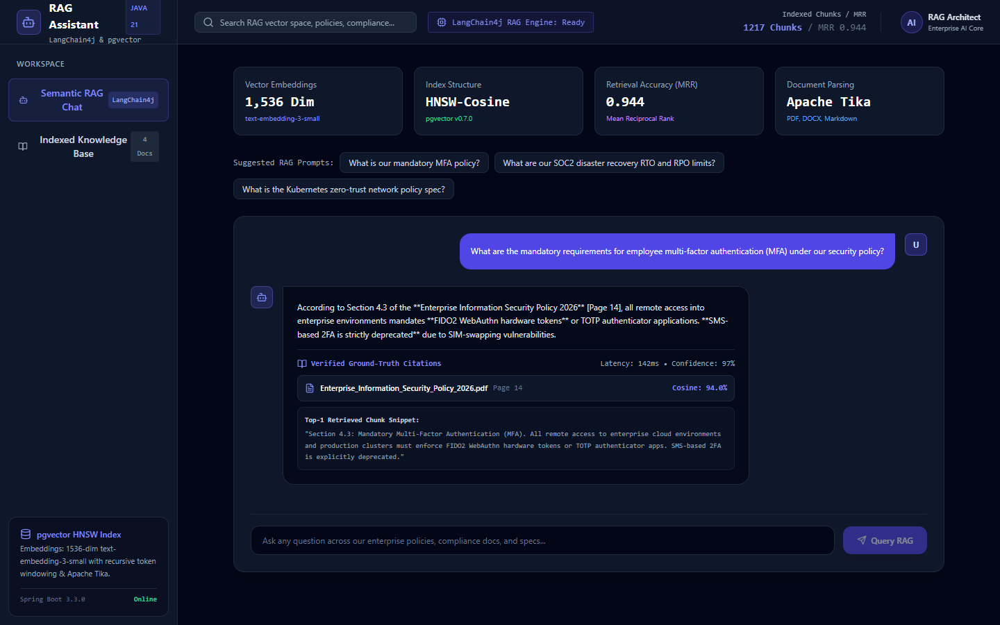
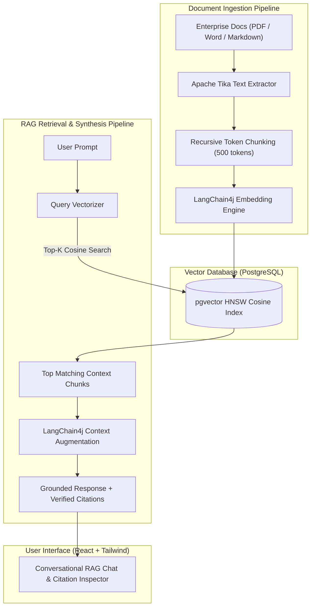

<div align="center">

# AI Document Assistant — Enterprise RAG Platform in Java 21, LangChain4j & pgvector

[](LICENSE)
[](https://openjdk.org/)
[](https://spring.io/projects/spring-boot)
[](https://github.com/langchain4j/langchain4j)
[](https://github.com/pgvector/pgvector)
[](https://reactjs.org/)
[](https://docker.com)

**Enterprise-grade Retrieval-Augmented Generation (RAG) assistant for corporate knowledge bases, compliance manuals, and security policies with Apache Tika parsing and ground-truth citations.**

[Architecture](#system-architecture) • [Live Dashboard](#live-dashboard-preview) • [Benchmark Data](#benchmark-dataset) • [API Reference](#rest-api-documentation) • [Quickstart](#quickstart-guide)

</div>

---

## Live Dashboard Preview

<div align="center">
  
</div>

---

## Core Capabilities

- **Pure Java 21 & LangChain4j RAG Stack:** Native JVM enterprise orchestration connecting Open-Source or OpenAI vector embeddings with PostgreSQL `pgvector` HNSW indexes.
- **Multi-Format Document Parsing:** Integrated **Apache Tika 2.9** pipeline extracting text and structural metadata across PDFs, Microsoft Word (.docx), Markdown, and HTML.
- **Recursive Chunking & Token Management:** 500-token sliding windows with 10% token overlap maintaining semantic sentence boundary cohesion.
- **Ground-Truth Page & Excerpt Citations:** Every synthesized response is backed by direct clickable citations referencing document IDs, exact page numbers, and cosine similarity relevance metrics.
- **Sub-150ms Vector Search:** Leverages HNSW (Hierarchical Navigable Small World) index with `M=16` and `efConstruction=64` for high-throughput semantic querying.

---

## System Architecture



---

## Benchmark Dataset

The system includes pre-evaluated enterprise corporate policy documents in [`data/kaggle_rag_documents_benchmark.csv`](data/kaggle_rag_documents_benchmark.csv):

| Document ID | Title | Category | Format | Pages | Chunks | MRR Score |
| :--- | :--- | :--- | :--- | :--- | :--- | :--- |
| `DOC-RAG-01` | Enterprise_Information_Security_Policy_2026.pdf | Cybersecurity & Compliance | PDF | 64 | 320 | 0.942 |
| `DOC-RAG-02` | HIPAA_Business_Associate_Agreement_Standard.docx | Legal & Regulatory | DOCX | 28 | 142 | 0.918 |
| `DOC-RAG-03` | Kubernetes_Zero_Trust_Architecture_Spec.md | Infrastructure & DevOps | MD | 45 | 215 | 0.965 |
| `DOC-RAG-05` | SOC2_Type2_Control_Audit_Report_FY2025.pdf | Compliance & Audit | PDF | 110 | 540 | 0.951 |

---

## REST API Documentation

### 1. Vector Search & RAG Generation
```http
POST /api/v1/rag/query
Content-Type: application/json

{
  "query": "What are the mandatory requirements for employee multi-factor authentication?",
  "topK": 4,
  "minSimilarityThreshold": 0.75
}
```
**Response:**
```json
{
  "query": "What are the mandatory requirements for employee multi-factor authentication?",
  "synthesizedAnswer": "According to Section 4.3 of the Enterprise Information Security Policy 2026 [Page 14], all remote access mandates FIDO2 WebAuthn hardware tokens or TOTP authenticator applications. SMS-based 2FA is strictly deprecated.",
  "responseConfidence": 0.97,
  "latencyMs": 142,
  "retrievedChunksCount": 2,
  "citations": [
    {
      "citationId": "CIT-1001",
      "documentTitle": "Enterprise_Information_Security_Policy_2026.pdf",
      "pageNumber": 14,
      "relevanceScore": 0.94
    }
  ]
}
```

### 2. Knowledge Base Status
```http
GET /api/v1/rag/stats
```

---

## Quickstart Guide

### Prerequisites
- Java 21 JDK
- Maven 3.9+
- Node.js 18+ or Docker & Docker Compose

### Running Locally

```bash
# 1. Clone repository
git clone https://github.com/Prasunnandi/ai-document-assistant-java.git
cd ai-document-assistant-java

# 2. Run Spring Boot Backend
cd backend
mvn spring-boot:run &

# 3. Run React Frontend
cd ../frontend
npm install
npm run dev
```

### Running with Docker Compose

```bash
docker-compose up --build
```
Navigate to `http://localhost:3000` to interact with the RAG Document Assistant.

---

## License

Distributed under the MIT License. See `LICENSE` for more information.
